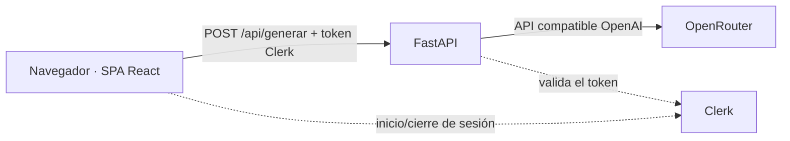

# Testia · Práctica UD1

Práctica UD1 del módulo *Explotación de Servicios de Procesamiento y Analítica de Datos* (Curso de especialización de IA). La miniapp genera un test de repaso a partir de unos apuntes; el foco de la práctica es **desplegarla, securizarla y operarla** en Vercel y AWS.

> Estado: en construcción. Las secciones marcadas con `TODO` se completan al cerrar cada hito.

## 1. Identificación

- **Miniapp:** generador de tests tipo test con feedback (apuntes + nº de preguntas + dificultad → preguntas con explicación).
- **Integrantes y aportaciones:** `TODO` (nombre · cuenta de GitHub · tareas).

## 2. Plan de documentación

- **Lectores:** quien corrige la práctica y cualquier persona que deba reproducir el despliegue desde cero.
- **Estructura:** un único README (esta página) con las 12 secciones del enunciado; capturas en `evidencias/`.
- **Actualización:** cada persona documenta su fase al cerrar el hito, con los comandos realmente usados y una captura (datos sensibles ocultos).
- **Guía consultada:** `TODO` ([Diátaxis](https://diataxis.fr/), [guía de Markdown de GitHub](https://docs.github.com/en/get-started/writing-on-github)).
- **Herramientas:** `TODO` (vista previa de Markdown, tablas, Mermaid, herramienta de capturas, Git).

## 3. Arquitectura



- **Vercel (serverless):** un único proyecto; el backend FastAPI se ejecuta como Vercel Function (runtime Python) y los estáticos de la SPA salen del CDN.
- **AWS (EC2 + Docker):** un único contenedor en el que FastAPI sirve la SPA compilada y la API.
- La clave de OpenRouter solo existe en el servidor; el navegador nunca llama al proveedor de IA.

## 4. Requisitos e instalación local

Versiones usadas: Python 3.13, Node 24, npm 11, Docker 29. `TODO` confirmar versiones finales.

```bash
# Backend
python -m venv .venv
.venv/Scripts/python -m pip install -e ".[dev]"   # Linux/macOS: .venv/bin/python
cp .env.example .env                               # y rellena tus valores
.venv/Scripts/python -m pytest                     # 4 tests, sin llamadas reales a la IA
.venv/Scripts/python -m uvicorn backend.app.main:app --reload --port 8000

# Frontend (en otra terminal)
cd frontend && npm ci && npm run dev               # http://localhost:5173 (proxy /api -> :8000)
```

Comprobación: abrir la SPA, pegar unos apuntes y generar un test; `GET /api/health` devuelve `{"status":"ok"}`.

## 5. Variables de entorno

| Variable | Finalidad | Tipo | Dónde se configura | Cuándo se usa |
| --- | --- | --- | --- | --- |
| `OPENROUTER_API_KEY` | Llamada al proveedor de IA | **Secreto** | `.env` local · Vercel env · `--env-file` en EC2 | Ejecución |
| `OPENROUTER_MODEL` | Modelos `:free` separados por comas (el primero es el principal; los demás, respaldo) | Config | idem | Ejecución |
| `OPENROUTER_TIMEOUT_SECONDS` | Timeout de la llamada | Config | idem | Ejecución |
| `CLERK_SECRET_KEY` | Validar la sesión en el backend | **Secreto** | idem | Ejecución |
| `CLERK_AUTHORIZED_PARTIES` | Orígenes permitidos (`azp`) | Config | idem | Ejecución |
| `VITE_CLERK_PUBLISHABLE_KEY` | Clerk en la SPA | Público | `.env` · Vercel env · `--build-arg` en Docker | **Compilación** (si cambia, recompilar) |

## 6. Vercel

**Organización (un único proyecto `testia` (creado como `test-repaso-ia` y renombrado dos veces)):** Vercel detecta FastAPI por `[tool.vercel] entrypoint` en `pyproject.toml` y lo ejecuta como una sola Vercel Function (Python 3.12). `vercel.json` define el build del frontend (`npm --prefix frontend ci && npm --prefix frontend run build`) y `maxDuration` de 60 s. El backend monta `frontend/dist`, que Vercel sirve desde el CDN; las rutas `/api/*` van a la función. No se usa Docker en Vercel.

**Operaciones reales con la CLI** (en Windows con PowerShell restringido se usó `vercel.cmd`):

| Comando | Finalidad | Resultado |
| --- | --- | --- |
| `vercel login` / `vercel whoami` | Autenticar y comprobar la sesión | Sesión iniciada |
| `vercel link --yes --project test-repaso-ia` | Crear y vincular el proyecto único | Detecta FastAPI; crea `.vercel/` (ignorado por Git) |
| `vercel env add NOMBRE production\|preview --sensitive` (valor por stdin) | Subir variables sin escribir el secreto en el comando | `OPENROUTER_API_KEY`, `OPENROUTER_MODEL`, `OPENROUTER_TIMEOUT_SECONDS` en Production y Preview |
| `vercel env ls` | Consultar nombres y entornos sin ver valores | Valores `Hidden` |
| `vercel env rm OPENROUTER_MODEL <entorno>` + `env add` | Actualizar una variable | Modelo cambiado a uno gratuito |
| `vercel deploy` | Despliegue de Preview | URL de preview `READY` |
| `vercel deploy --prod` | Publicar el despliegue final | Alias `https://testia.vercel.app` (y los anteriores `expl-p1` y `test-repaso-ia`) |
| `vercel project rename test-repaso-ia expl-p1` | Cambiar el nombre del proyecto | Proyecto `expl-p1` |
| `vercel domains add expl-p1.vercel.app expl-p1` | Asignar la URL corta al proyecto | `expl-p1.vercel.app` responde en producción |
| `vercel project rename expl-p1 testia` + `vercel domains add testia.vercel.app testia` | Nombre definitivo de la app: **Testia** | `testia.vercel.app` responde en producción |
| `vercel curl /api/health --deployment <url>` | Probar con *Deployment Protection* activa | `{"status":"ok"}` |
| `vercel logs --deployment <url> --no-follow --since 15m` | Diagnosticar | Reveló un `403` de OpenRouter (ver sección 11) |
| `vercel inspect <url>` | Inspeccionar alias y función | Una función `fastapi` en `iad1` |

**URL de producción:** https://testia.vercel.app (protegida por *Vercel Authentication*; se verifica con `vercel curl`). **Versión desplegada:** `TODO` (anotar tag/commit; el despliegue se hizo desde la carpeta local).

## 7. Clerk

`TODO` (Fase 4): instancia de desarrollo, inicio/cierre de sesión, orígenes, validación en FastAPI y evidencia del rechazo sin token. Nota: la etiqueta *Production* de Vercel no convierte la instancia de desarrollo de Clerk en producción.

## 8. Docker

`TODO` (Fase 5): construir, ejecutar, parar, reiniciar, logs, puerto y variables.

## 9. AWS

`TODO` (Fase 6): EC2 (región, SO, tipo), Docker, ejecución, Security Group, URL y versión desplegada. Limitación a documentar: en EC2 la aplicación va por **HTTP sin cifrar**, por lo que solo debe usarse con datos y cuentas de prueba.

## 10. Operación y verificación

`TODO`: tests y resultados, comprobaciones manuales en ambos entornos, estado/logs, actualización y reinicio, retirada de recursos al terminar.

## 11. Problemas y soluciones

1. **JSON incompleto / 502 con modelos gratuitos.** *Síntoma:* `RespuestaInvalida: JSON mal formado` o `Respuesta vacía`. *Diagnóstico:* con `finish_reason=length` y el contenido empezando por "Here's a thinking process", el modelo (de razonamiento) gastaba los tokens pensando. *Solución:* enviar `reasoning: {enabled: false}` en `extra_body` y subir `max_tokens`. *Comprobación:* prueba real de 3 y 10 preguntas con modelos `:free` (5,7 s y 6,7 s).
2. **`403 Forbidden` de OpenRouter solo en Vercel.** *Síntoma:* 502 controlado en `/api/generar` desplegado. *Diagnóstico:* `vercel logs` mostró `POST https://openrouter.ai/... 403`; la clave no tiene saldo y el modelo configurado era de pago. *Solución:* usar solo modelos `:free` (con lista de respaldo, porque a veces responden `429`). *Comprobación:* `200 OK` desde el despliegue de Preview.
3. **`.gitignore` modificado por la CLI.** `vercel link` añadió `.env*`, que anulaba `!.env.example`; se eliminó esa línea porque `.vercel/` y `.env.*` ya estaban cubiertos.
4. **PowerShell bloquea `npm`/`vercel`** (`running scripts is disabled`): se usaron `npm.cmd` y `vercel.cmd`, sin cambiar la política de ejecución.
5. **El `.env` se subió a Vercel con el código.** *Síntoma:* al comparar el código desplegado con el local (`vercel api /v6/deployments/<id>/files`, hash SHA-1 de cada archivo), el árbol contenía `.env`, `.pytest_cache`, `egg-info` y un `dist` antiguo. *Diagnóstico:* sin repositorio Git la CLI no aplica el `.gitignore`. *Solución:* añadir `.vercelignore` (excluye `.env*`, cachés, `frontend/dist`) y redesplegar; el nuevo despliegue tiene 26 archivos fuente, todos idénticos a los locales y sin secretos. *Pendiente:* los despliegues anteriores aún contienen el `.env`; se recomienda rotar la clave de OpenRouter y retirar esos despliegues.
6. *(Pendiente de completar con las incidencias de Clerk, Docker y AWS.)*

## 12. Git y evidencias

| Tag | Hito | Despliegue |
| --- | --- | --- |
| `TODO` | | |

Evidencias en [`evidencias/`](evidencias/): `TODO` (qué demuestra cada captura).
