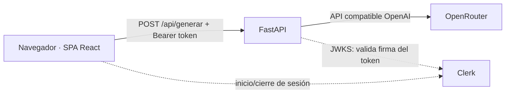

# Testia · Práctica UD1

Práctica UD1 del módulo *Explotación de Servicios de Procesamiento y Analítica de Datos* (Curso de especialización de IA). La miniapp genera un test de repaso a partir de unos apuntes; el foco de la práctica es **desplegarla, securizarla y operarla** en Vercel y AWS.

| Entorno | URL | Versión desplegada |
| --- | --- | --- |
| Vercel (serverless) | https://testia.vercel.app | `v1.1-vercel` (revisión de noviembre; despliegue `dpl_8zokEQi8BtiQoH2GQZRAHHafYkmz`) |
| AWS EC2 (Docker) | http://54.235.82.94 | `v1.1-vercel` (imagen `testia:0406d72`; antes `v1.0-aws`, `testia:55ccc4d`) |

Presentación de la defensa: [`presentacion/Testia-Defensa_UD1.pdf`](presentacion/Testia-Defensa_UD1.pdf) (15 diapositivas ordenadas según la rúbrica, versión `v1.1-vercel`) y su guion con las notas de cada diapositiva y la demo paso a paso: [`presentacion/guion-defensa.md`](presentacion/guion-defensa.md).

> Estado: los dos entornos ejecutan `v1.1-vercel` (clave de IA rotada, modelos gratuitos renovados, carga sin saltos, registro visible). Vercel verificado con sesión real, test generado y rechazo sin token; EC2 actualizado con el procedimiento de la sección 10 y verificado desde fuera (SPA nueva, `/api/health`, `401` sin token, IA real desde el contenedor, reinicio).

## 1. Identificación

- **Miniapp:** generador de tests tipo test con feedback (apuntes + nº de preguntas + dificultad → preguntas con explicación). Una pantalla, un formulario y una única operación de IA. La interfaz cabe en una pantalla de escritorio (el test se desplaza por dentro) y tiene un fondo decorativo de puntos en movimiento dibujado en `<canvas>` ([`FondoOndas.tsx`](frontend/src/FondoOndas.tsx): ~30 fps, se pausa con la pestaña oculta y queda quieto si el sistema pide *reducir movimiento*).
- **Integrantes:** trabajo individual (autorizado) de **Juan Amador** · GitHub [`amador-h`](https://github.com/amador-h). Se encarga de todo: backend, frontend, Vercel, Clerk, Docker, AWS, pruebas y documentación.

## 2. Plan de documentación

- **Lectores:** quien corrige la práctica y cualquier persona que deba reproducir el despliegue desde cero (sabe usar terminal, Git y Docker, pero no conoce el proyecto).
- **Tipo de documento:** siguiendo [Diátaxis](https://diataxis.fr/), el README combina *how-to* (pasos reproducibles por entorno), *referencia* (tabla de variables, comandos) y una breve *explicación* (arquitectura y decisiones). No incluye tutoriales genéricos.
- **Estructura:** un único README con las 12 secciones del enunciado; capturas en [`evidencias/`](evidencias/).
- **Actualización:** se documenta cada fase al cerrar su hito, con los comandos realmente usados y su captura (datos sensibles ocultos); el tag de Git marca qué versión describe cada sección.
- **Herramientas:** Markdown con vista previa (VS Code / GitHub), tablas y enlaces relativos, [Mermaid](https://mermaid.js.org/) para el esquema, recortes de pantalla con ocultación de datos, Git para revisar los cambios. Guía de formato: [Markdown de GitHub](https://docs.github.com/en/get-started/writing-on-github).

## 3. Arquitectura



1. La SPA inicia sesión con Clerk y obtiene un token de sesión (JWT de vida corta).
2. Envía los apuntes a `POST /api/generar` con `Authorization: Bearer <token>`.
3. FastAPI valida el token (firma, caducidad y origen `azp`) **antes** de llamar a la IA; sin token válido responde `401`.
4. FastAPI llama a OpenRouter con su clave (solo existe en el servidor), valida el JSON del modelo y lo devuelve.

| | Vercel | AWS EC2 |
| --- | --- | --- |
| Ejecución del backend | Vercel Function (Python), se arranca por petición | Proceso `uvicorn` permanente dentro de un contenedor |
| SPA | Estáticos de `frontend/dist` servidos por la CDN de Vercel | Servidos por FastAPI (`StaticFiles`) en el mismo contenedor |
| Compilación | Vercel ejecuta `buildCommand` en cada despliegue | `docker build` multietapa |
| Secretos | Variables de entorno de Vercel | Archivo privado `--env-file` en la instancia |
| HTTPS | Incluido | No (HTTP, solo demo con cuentas de prueba) |

## 4. Requisitos e instalación local

Versiones usadas: Python 3.13–3.14 (local) / 3.12 (Vercel y Docker), Node 24, npm 11, Docker 28, Git 2.48+, Vercel CLI 63 (local; el build de Vercel usa la 65). Dependencias principales (revisión de noviembre): FastAPI 0.162, openai 3.x, clerk-backend-api 7.1, React 19, Vite 8.3, Tailwind 4.3, @clerk/react 6.17, @clerk/localizations 4.23.

```bash
# Backend
python -m venv .venv
.venv/Scripts/python -m pip install -e ".[dev]"   # Linux/macOS: .venv/bin/python
cp .env.example .env                               # y rellena tus valores
.venv/Scripts/python -m pytest                     # 7 tests, sin llamadas reales a la IA
.venv/Scripts/python -m uvicorn backend.app.main:app --reload --port 8000

# Frontend (en otra terminal)
cd frontend && npm ci && npm run dev               # http://localhost:5173 (proxy /api -> :8000)
```

Vite lee el mismo `.env` de la raíz (`envDir: '..'`) y solo expone al navegador las variables `VITE_*`.

Comprobación: `GET /api/health` devuelve `{"status":"ok"}`; en la SPA, sin sesión el botón pide iniciar sesión (o crear cuenta) y, con sesión, se genera el test. *Probar con un ejemplo* rellena unos apuntes de muestra.

## 5. Variables de entorno

| Variable | Finalidad | Tipo | Dónde se configura | Cuándo se usa |
| --- | --- | --- | --- | --- |
| `OPENROUTER_API_KEY` | Llamada al proveedor de IA | **Secreto** | `.env` local · Vercel (Production/Preview) · `--env-file` en EC2 | Ejecución |
| `OPENROUTER_MODEL` | Modelos `:free` separados por comas (el primero es el principal; los demás, respaldo) | Config | idem | Ejecución |
| `OPENROUTER_TIMEOUT_SECONDS` | Timeout de la llamada | Config | idem | Ejecución |
| `CLERK_SECRET_KEY` | Validar la sesión en el backend (descarga la JWKS) | **Secreto** | idem | Ejecución |
| `CLERK_AUTHORIZED_PARTIES` | Orígenes de la SPA admitidos en el claim `azp`. `*` = un trozo de subdominio | Config | idem (valor distinto por entorno) | Ejecución |
| `VITE_CLERK_PUBLISHABLE_KEY` | Clerk en la SPA | Público (va en el bundle) | `.env` · Vercel · `--build-arg` en Docker | **Compilación** (si cambia, recompilar/reconstruir) |

Valores de `CLERK_AUTHORIZED_PARTIES` por entorno:

| Entorno | Valor |
| --- | --- |
| Local | `http://localhost:5173,http://localhost:8080` |
| Vercel Production | `https://testia.vercel.app,https://expl-p1.vercel.app,https://test-repaso-ia.vercel.app` |
| Vercel Preview | `https://testia-*-ies-zaidin-vergeles.vercel.app` (cada Preview tiene una URL distinta) |
| EC2 | `http://54.235.82.94` |

## 6. Vercel

**Organización (un único proyecto `testia`, equipo `ies-zaidin-vergeles`):** Vercel detecta FastAPI por `[tool.vercel] entrypoint` en `pyproject.toml` y lo ejecuta como una sola Vercel Function (Python 3.12, región `iad1`). `vercel.json` define el build del frontend (`npm --prefix frontend ci && npm --prefix frontend run build`) y `maxDuration` de 60 s. El backend monta `frontend/dist`, que Vercel sirve desde la CDN; las rutas `/api/*` van a la función. `.vercelignore` evita subir `.env`, cachés y artefactos. No se usa Docker en Vercel.

**Operaciones reales con la CLI** (en Windows con PowerShell restringido se usó `vercel.cmd`):

| Comando | Finalidad | Resultado |
| --- | --- | --- |
| `vercel login` / `vercel whoami` | Autenticar y comprobar la sesión | Sesión iniciada |
| `vercel link --yes --project test-repaso-ia` | Crear y vincular el proyecto único | Detecta FastAPI; crea `.vercel/` (ignorado por Git) |
| `vercel env add NOMBRE production\|preview --sensitive` (valor por stdin) | Subir variables sin escribir el secreto en el comando | `OPENROUTER_*` y después `CLERK_SECRET_KEY`, `CLERK_AUTHORIZED_PARTIES`, `VITE_CLERK_PUBLISHABLE_KEY` en Production y Preview |
| `vercel env ls` | Consultar nombres y entornos sin ver valores | Secretos como `Hidden` |
| `vercel env rm OPENROUTER_MODEL <entorno>` + `env add` | Actualizar una variable | Modelo cambiado a uno gratuito |
| `vercel deploy` | Despliegue de Preview | `testia-jhmhhp9ni-…vercel.app` `READY` |
| `vercel curl /api/generar --deployment <url> -- -X POST …` | Probar la Preview (protegida por *Vercel Authentication*) | `401` + `WWW-Authenticate: Bearer` sin token |
| `vercel deploy --prod` | Publicar el despliegue final | Alias `https://testia.vercel.app` |
| `vercel ls testia` | Consultar los despliegues del proyecto | Preview y Production `Ready` |
| `vercel project inspect testia` | Ver preset, build y región | FastAPI, `iad1` |
| `vercel project rename …` + `vercel domains add …` | Nombre definitivo de la app: **Testia** | `testia.vercel.app` responde en producción |
| `vercel logs --environment production --since 2h --no-follow` | Diagnosticar | Muestra los rechazos `SESSION_TOKEN_MISSING` / `TOKEN_INVALID` y, antes, un `403` de OpenRouter (ver sección 11) |
| `vercel inspect <url>` | Inspeccionar alias y función | Una función `fastapi` en `iad1` |
| `vercel env rm OPENROUTER_API_KEY <entorno>` + `vercel env add … --sensitive --yes` (valor por stdin) | Rotar la clave de OpenRouter caducada (noviembre) | Clave nueva en Production y Preview, mostrada como `Hidden` |
| `vercel env rm/add OPENROUTER_MODEL <entorno>` | Sustituir los modelos gratuitos retirados | Lista nueva en ambos entornos (incidencia 14) |
| `vercel deploy` → comprobar → `vercel deploy --prod` | Publicar `v1.1-vercel` validando antes la Preview | Preview `READY` con `/api/health` `200` y `401` sin token; después alias `https://testia.vercel.app` |
| `vercel api /v6/deployments/<id>/files` | Ver qué archivos se subieron al despliegue | 27 archivos fuente, sin `.env` ni claves |
| `vercel logs --environment production --since 1h --no-follow` | Verificar la IA tras la rotación | `POST /api/generar` → OpenRouter `200 OK`; rechazos `SESSION_TOKEN_MISSING`/`TOKEN_INVALID` sin token |

Subida de un secreto sin que aparezca en el comando ni en el historial (PowerShell):

```powershell
$sk = (Get-Content .env | Where-Object { $_ -match '^CLERK_SECRET_KEY=' }) -replace '^CLERK_SECRET_KEY=', ''
$sk | vercel.cmd env add CLERK_SECRET_KEY production --sensitive --yes
Remove-Variable sk
```

Variables del proyecto (`vercel env ls`; los secretos no se pueden leer, la clave pública se muestra como tal):

```console
 name                         value            type     environments
 CLERK_AUTHORIZED_PARTIES     Hidden           Secret   Preview / Production
 CLERK_SECRET_KEY             Hidden           Secret   Preview / Production
 VITE_CLERK_PUBLISHABLE_KEY   (valor público)  Config   Preview / Production
 OPENROUTER_API_KEY           Hidden           Secret   Preview / Production
 OPENROUTER_MODEL             Hidden           Secret   Preview / Production
 OPENROUTER_TIMEOUT_SECONDS   Hidden           Secret   Preview / Production
```

**URL y versión desplegada:** https://testia.vercel.app · tag `v1.1-vercel` (despliegue de producción `dpl_8zokEQi8BtiQoH2GQZRAHHafYkmz`, creado con `vercel deploy --prod` desde el árbol de trabajo de ese tag).

**Protección:** las Preview siguen protegidas por *Vercel Authentication* (*Standard Protection*); la URL de producción es pública para la evaluación, y la API de IA la protege Clerk.

## 7. Clerk

- **Instancia:** aplicación `TestIA` (antes `IZV`) en entorno de **desarrollo** (claves `pk_test_` / `sk_test_`), como indica el enunciado. La etiqueta *Production* de Vercel no la convierte en producción. Desde la revisión de noviembre, la SPA oculta la etiqueta *Development mode* de los modales (`appearance.options.unsafe_disableDevelopmentModeWarnings`): es solo estética, la instancia sigue siendo de desarrollo (la consola del navegador lo sigue avisando y las capturas de `evidencias/` muestran la etiqueta). Pasar a producción exigiría un dominio propio.
- **Configuración** (*Configure → User & authentication*): registro e inicio de sesión con **correo electrónico + código de verificación** (sin enlace mágico) y botón *Continuar con Google*. No se ha creado ninguna base de datos propia: las identidades las gestiona Clerk.
- **Cuentas:** las pruebas se hicieron con la cuenta del centro del alumno (sus datos se ocultan en las capturas). Para la demo se usa un usuario de prueba creado en *Users*, sin datos personales.
- **Comprobación en Clerk:** *Logs → Application* registra `sign_in.created`, `sign_in.email_address.verified`, `sign_in.completed` y `session.created` para cada inicio de sesión.
- **SPA** (`@clerk/react`): `ClerkProvider` con la clave pública, textos en español y los colores de la app. En la cabecera, *Iniciar sesión* y *Crear cuenta* (modales de Clerk `SignInButton`/`SignUpButton`) o, con sesión, *Cerrar sesión* + `UserButton`. Sin sesión, el botón del formulario abre el inicio de sesión y debajo hay un enlace *Créala gratis* al registro. Mientras Clerk carga (`useAuth().isLoaded`) se pintan huecos del mismo tamaño que los botones, para que la página no salte. Al enviar, `getToken()` obtiene el token y se manda como `Authorization: Bearer`.
- **Registro de usuarios:** lo gestiona Clerk (modo de registro *Public*, correo + contraseña o Google); la app no guarda usuarios. Clerk es quien envía el código de verificación del correo.
- **Backend** ([`backend/app/auth.py`](backend/app/auth.py)): dependencia `usuario_autenticado` en `POST /api/generar` con el SDK oficial `clerk-backend-api` (`authenticate_request`): descarga la JWKS con `CLERK_SECRET_KEY`, comprueba **firma**, **caducidad** (`exp`/`nbf`), que el token sea de sesión y que el **`azp`** esté en `CLERK_AUTHORIZED_PARTIES`. Si falla → `401` con `WWW-Authenticate: Bearer` y la IA no se llama. Si falta `CLERK_SECRET_KEY` o `CLERK_AUTHORIZED_PARTIES`, responde `503` y tampoco llama a la IA (la configuración incompleta cierra el paso en lugar de aceptar cualquier origen). En los logs solo se registra el motivo (`SESSION_TOKEN_MISSING`, `TOKEN_INVALID`, `AZP_NO_PERMITIDO`…), nunca el token. `/api/health` sigue siendo público y no revela nada.
- **Orígenes y redirecciones:** no se usa CORS (SPA y API comparten origen en todos los entornos). La instancia de desarrollo de Clerk acepta cualquier origen, así que el control está en el backend: `CLERK_AUTHORIZED_PARTIES` fija, por entorno, qué orígenes (`azp`) son válidos (tabla de la sección 5). El inicio de sesión es un modal (sin redirección de ida) y tras cerrar sesión se vuelve a `/` (`afterSignOutUrl`), que es la misma ruta en Vercel, Docker y EC2; por eso no hay que registrar URLs de redirección.
- **Ocultar el botón no es la protección:** la protección real es la validación en FastAPI.

Rechazo sin token en producción (`cuerpo.json` = `{"apuntes":"La fotosíntesis convierte luz en energía","num_preguntas":3}`):

```console
$ curl -i -X POST https://testia.vercel.app/api/generar -H "Content-Type: application/json" --data-binary @cuerpo.json
HTTP/1.1 401 Unauthorized
Www-Authenticate: Bearer
{"detail":"Necesitas iniciar sesión para generar un test."}
```

Con un token inventado (`Authorization: Bearer token-inventado`) también responde `401` (log: `TOKEN_INVALID`).

> En PowerShell conviene pasar el cuerpo con `--data-binary @fichero`: si se escribe el JSON en línea, las comillas llegan mal y FastAPI responde `422` (JSON mal formado) antes de mirar la sesión.

## 8. Docker

Una sola imagen con la app completa ([`Dockerfile`](Dockerfile)), construida en dos etapas: `node:24-alpine` compila la SPA y `python:3.12-slim` ejecuta FastAPI, que sirve `/api/*` y la SPA. La imagen final no contiene Node, tests, `.env` ni la carpeta `.git` ([`.dockerignore`](.dockerignore)); se ejecuta con un usuario sin privilegios y tiene `HEALTHCHECK` contra `/api/health`.

```bash
# Construir (la clave PÚBLICA de Clerk entra en el bundle; los secretos NO van en la imagen)
docker build --build-arg VITE_CLERK_PUBLISHABLE_KEY=pk_test_... -t testia:$(git rev-parse --short HEAD) .

# Ejecutar: secretos inyectados al arrancar desde un archivo privado
docker run -d --name testia --env-file .env -p 8080:8000 --restart unless-stopped testia:<commit>

docker ps --filter name=testia          # estado (healthy)
docker logs --tail 50 testia            # logs
docker stop testia && docker start testia
docker restart testia
docker rm -f testia                     # retirar
```

- **Puerto:** `uvicorn` escucha en `0.0.0.0:8000` dentro del contenedor (en `127.0.0.1` no llegaría el tráfico del puerto publicado); en local se publica en `8080` y en EC2 en `80`.
- **Etiqueta de la imagen:** el commit corto, para saber qué versión corre (`docker ps` muestra `testia:2e6f869`).
- **Parar e iniciar** (comprobado): `docker stop testia` → `Exited (0)`; `docker start testia` → `Up … (healthy)` y `/api/health` → `200`.
- **Prueba local:** contenedor `healthy`, SPA en http://localhost:8080, inicio de sesión con Clerk y test generado (`200`), `401` sin token, ningún secreto en `docker history`, proceso como usuario `app`.

```console
$ docker ps --filter name=testia --format '{{.Names}} {{.Image}} {{.Status}} {{.Ports}}'
testia testia:2e6f869 Up 6 minutes (healthy) 0.0.0.0:8080->8000/tcp
$ docker logs testia | grep generar
Petición rechazada por autenticación: SESSION_TOKEN_MISSING
INFO:     172.17.0.1:45316 - "POST /api/generar HTTP/1.1" 401 Unauthorized
INFO:     172.17.0.1:51944 - "POST /api/generar HTTP/1.1" 200 OK
```

## 9. AWS

**Cuenta:** AWS Academy *Learner Lab* (región `us-east-1`; credenciales temporales de la sesión del lab en `~/.aws/credentials`, nunca en el repositorio). Todo se creó con la **AWS CLI 2.37** desde PowerShell, para que los pasos sean reproducibles. La actualización de noviembre se hizo desde otro equipo con la AWS CLI 1.46 (paquete oficial `awscli` instalado con `pip` en un entorno virtual, sin permisos de administrador).

| Recurso | Valor | Motivo |
| --- | --- | --- |
| Instancia | `i-0b4ff0c5a687e115d` · `testia` · `us-east-1b` | — |
| Sistema | Amazon Linux 2023 (AMI oficial más reciente, leída de SSM) · x86_64 | Linux mantenido por AWS, con `dnf` y Docker en sus repositorios |
| Tipo | `t3.micro` (2 vCPU, 1 GiB) + **2 GiB de swap** | Suficiente para un contenedor; el swap evita quedarse sin memoria al compilar la SPA |
| Disco | gp3 de 16 GiB | Imágenes de Node y Python durante la construcción |
| IP | **IP elástica `54.235.82.94`** | El lab detiene la instancia al acabar la sesión; sin IP fija cambiarían la URL y `CLERK_AUTHORIZED_PARTIES` |
| Metadatos | IMDSv2 obligatorio | Buena práctica de seguridad |
| Clave SSH | `testia-ec2` (ED25519), privada solo en el PC del administrador (`~/.ssh/`, permisos solo para su usuario) | No se usa la clave compartida del lab |

**Security Group `testia-sg`** (reglas de entrada; la salida se deja por defecto para instalar paquetes y llamar a OpenRouter y Clerk):

| Protocolo | Puerto | Origen | Para qué |
| --- | --- | --- | --- |
| TCP | 22 | `IP_DEL_ADMINISTRADOR/32` | SSH solo desde el equipo del administrador |
| TCP | 80 | `0.0.0.0/0` | Web pública para la demo y la evaluación |

No se abren el 8000 (puerto interno del contenedor) ni el 2375/2376 (API de Docker): comprobado con `Test-NetConnection 54.235.82.94 -Port 8000` y `-Port 2375` → `False`.

**Creación de la infraestructura** (comandos usados, resumidos):

```powershell
$miIp = (curl.exe -s https://checkip.amazonaws.com).Trim()
aws ec2 create-key-pair --key-name testia-ec2 --key-type ed25519 --query KeyMaterial --output text > ~/.ssh/testia-ec2.pem
icacls ~/.ssh/testia-ec2.pem /inheritance:r /grant:r "$($env:USERNAME):(R)"
aws ec2 create-security-group --group-name testia-sg --vpc-id <vpc-por-defecto> --description "..."
aws ec2 authorize-security-group-ingress --group-id <sg> --ip-permissions `
  "IpProtocol=tcp,FromPort=22,ToPort=22,IpRanges=[{CidrIp=$miIp/32}]" `
  "IpProtocol=tcp,FromPort=80,ToPort=80,IpRanges=[{CidrIp=0.0.0.0/0}]"
$ami = aws ssm get-parameter --name /aws/service/ami-amazon-linux-latest/al2023-ami-kernel-default-x86_64 --query Parameter.Value --output text
aws ec2 run-instances --image-id $ami --instance-type t3.micro --key-name testia-ec2 --security-group-ids <sg> `
  --block-device-mappings "DeviceName=/dev/xvda,Ebs={VolumeSize=16,VolumeType=gp3}" --metadata-options "HttpTokens=required" `
  --tag-specifications "ResourceType=instance,Tags=[{Key=Name,Value=testia}]"
aws ec2 allocate-address --domain vpc
aws ec2 associate-address --instance-id <id> --allocation-id <eipalloc>
```

**Preparación de la instancia** (`ssh -i ~/.ssh/testia-ec2.pem ec2-user@54.235.82.94`):

```bash
sudo dd if=/dev/zero of=/swapfile bs=1M count=2048 && sudo chmod 600 /swapfile && sudo mkswap /swapfile && sudo swapon /swapfile
echo '/swapfile swap swap defaults 0 0' | sudo tee -a /etc/fstab
sudo dnf install -y docker git
sudo systemctl enable --now docker          # arranca con el sistema
sudo usermod -aG docker ec2-user
docker --version                            # Docker version 25.0.14
sudo docker run --rm hello-world            # comprobación (imagen borrada después)
```

**Código y versión:** la imagen se construye en la instancia a partir del repositorio público, en el tag que se despliega, y se etiqueta con su commit:

```bash
sudo mkdir -p /opt/testia && sudo chown ec2-user: /opt/testia && cd /opt/testia
git clone https://github.com/amador-h/testia.git app && cd app
git checkout v1.1-vercel                    # en octubre: v1.0-aws
docker build --build-arg VITE_CLERK_PUBLISHABLE_KEY=pk_test_... -t testia:$(git rev-parse --short HEAD) .
```

**Variables en EC2:** archivo privado `/opt/testia/testia.env` (fuera del repositorio clonado, `chmod 600`, dueño `ec2-user`) con `OPENROUTER_*`, `CLERK_SECRET_KEY` y `CLERK_AUTHORIZED_PARTIES=http://54.235.82.94`. Se creó enviando el contenido por la entrada estándar de SSH (`... | ssh ec2-user@IP "umask 077; cat > /opt/testia/testia.env"`), así que los valores no aparecen en ningún comando ni en el historial. La clave pública de Clerk no va en este archivo: entra en el bundle con `--build-arg`. En noviembre solo se sustituyeron `OPENROUTER_API_KEY` y `OPENROUTER_MODEL`, enviando esas dos líneas por stdin y reemplazándolas en el archivo (sigue con `600` y las variables de Clerk intactas).

**Administrar desde otro equipo sin copiar la clave privada** (usado en noviembre): se añade una regla SSH temporal con la IP del equipo, se entra con una clave efímera publicada con **EC2 Instance Connect** (válida 60 s) y al terminar se revoca la regla. El Security Group vuelve a sus dos reglas y no queda ninguna clave en la instancia.

```bash
aws ec2 authorize-security-group-ingress --group-id <sg> --ip-permissions "IpProtocol=tcp,FromPort=22,ToPort=22,IpRanges=[{CidrIp=<ip-del-equipo>/32}]"
ssh-keygen -t ed25519 -N "" -f ec2-temporal
aws ec2-instance-connect send-ssh-public-key --instance-id i-0b4ff0c5a687e115d --instance-os-user ec2-user \
  --availability-zone us-east-1b --ssh-public-key file://ec2-temporal.pub
ssh -i ec2-temporal ec2-user@54.235.82.94          # en los 60 s siguientes
aws ec2 revoke-security-group-ingress --group-id <sg> --ip-permissions "IpProtocol=tcp,FromPort=22,ToPort=22,IpRanges=[{CidrIp=<ip-del-equipo>/32}]"
```

**Ejecución (un único contenedor):**

```bash
docker run -d --name testia --env-file /opt/testia/testia.env -p 80:8000 --restart unless-stopped testia:<commit>
```

`--restart unless-stopped`: el contenedor vuelve a arrancar si se cae o si se reinicia la instancia (comprobado con `sudo systemctl reboot`), salvo que se haya parado a mano.

**Limitación: HTTP sin cifrar.** En EC2 no hay HTTPS (simplificación permitida por el enunciado), así que el token de sesión de Clerk y los apuntes viajan en claro y podrían leerse en una red no confiable. Solo se usan cuentas y textos de prueba. Clerk funciona en este origen con su instancia de desarrollo (comprobado: `window.Clerk.loaded = true` aunque `isSecureContext = false`). En un entorno real se usaría un dominio con certificado TLS.

**Evidencias de la instancia** (AWS CLI; IP del administrador y de los clientes enmascaradas):

```console
$ aws ec2 describe-instances --instance-ids i-0b4ff0c5a687e115d --output table --query ...
|  Id           |  i-0b4ff0c5a687e115d    |
|  Nombre       |  testia                 |
|  Tipo         |  t3.micro               |
|  Estado       |  running                |
|  AZ           |  us-east-1b             |
|  IP           |  54.235.82.94           |
|  Arquitectura |  x86_64                 |
|  AMI          |  ami-097855b862d5b1eb2  (al2023-ami-2023.12.20261012.0-kernel-6.18-x86_64)

$ aws ec2 describe-security-groups --group-names testia-sg --output table --query ...
|     Descripcion    |   Origen       | Protocolo | Puerto |
|  HTTP app Testia   |  0.0.0.0/0     |  tcp      |  80    |
|  SSH administrador |  IP_ADMIN/32   |  tcp      |  22    |

$ ssh ec2-user@54.235.82.94 "docker ps; docker logs testia | grep generar"
NAMES     IMAGE            STATUS                    PORTS
testia    testia:c1347c2   Up 12 minutes (healthy)   0.0.0.0:80->8000/tcp, :::80->8000/tcp
Petición rechazada por autenticación: SESSION_TOKEN_MISSING
INFO:     IP_CLIENTE - "POST /api/generar HTTP/1.1" 401 Unauthorized
Petición rechazada por autenticación: TOKEN_INVALID
INFO:     IP_CLIENTE - "POST /api/generar HTTP/1.1" 401 Unauthorized
INFO:     IP_CLIENTE - "POST /api/generar HTTP/1.1" 200 OK
```

Estado tras la actualización de noviembre (`v1.1-vercel`):

```console
$ docker ps --format '{{.Names}} {{.Image}} {{.Status}} {{.Ports}}'
testia testia:0406d72 Up 32 seconds (healthy) 0.0.0.0:80->8000/tcp, :::80->8000/tcp
$ docker inspect testia --format 'reinicio={{.HostConfig.RestartPolicy.Name}} usuario={{.Config.User}}'
reinicio=unless-stopped usuario=app
$ docker images testia
testia:0406d72   184MB   (v1.1-vercel, en ejecución)
testia:55ccc4d   180MB   (v1.0-aws, se conserva para volver atrás)
$ docker logs testia | grep generar
Petición rechazada por autenticación: SESSION_TOKEN_MISSING
INFO:     IP_CLIENTE - "POST /api/generar HTTP/1.1" 401 Unauthorized
Petición rechazada por autenticación: TOKEN_INVALID
INFO:     IP_CLIENTE - "POST /api/generar HTTP/1.1" 401 Unauthorized
```

## 10. Operación y verificación

**Tests automáticos** (`pytest`, sin llamadas de pago, IA simulada):

| Test | Qué comprueba |
| --- | --- |
| `test_entrada_valida_con_proveedor_simulado` | Petición válida → `200` con la estructura JSON esperada |
| `test_entrada_incorrecta_devuelve_422` | Apuntes vacíos, demasiadas preguntas o texto demasiado largo → `422` |
| `test_fallo_del_proveedor_es_error_controlado` | Error del proveedor → `502` sin filtrar detalles internos |
| `test_json_invalido_del_modelo_es_error_controlado` | El modelo devuelve algo que no es JSON → `502` |
| `test_sin_token_valido_se_rechaza_sin_llamar_a_la_ia` | Sin token o con token falso → `401` y la IA no se llama (validación real con el SDK) |
| `test_configuracion_de_clerk_incompleta_bloquea_la_ia` | Sin `CLERK_AUTHORIZED_PARTIES` → `503` y la IA no se llama (no se acepta cualquier origen) |
| `test_origenes_permitidos_admiten_comodin_de_preview` | El comodín de `azp` acepta las Preview y rechaza otros dominios |

Resultado: `7 passed`.

**Comprobaciones manuales:**

| Comprobación | Vercel | EC2 |
| --- | --- | --- |
| SPA carga | `200` | `200` |
| `GET /api/health` | `{"status":"ok"}` | `{"status":"ok"}` (desde fuera de AWS) |
| `POST /api/generar` sin token | `401` + `WWW-Authenticate: Bearer` | `401` + `WWW-Authenticate: Bearer` |
| Con token inventado | `401` (`TOKEN_INVALID`) | `401` (`TOKEN_INVALID`) |
| Inicio de sesión + test generado | `200`, OpenRouter `200 OK` | `200` |
| Puertos no publicados (8000, 2375) | — | Cerrados |

Última verificación en Vercel (`v1.1-vercel`, noviembre), desde fuera y sin sesión de Vercel: SPA `200`, `/api/health` `{"status":"ok"}`, `POST /api/generar` sin token y con token inventado → `401`; con sesión de Clerk, test de 5 preguntas generado (OpenRouter `200 OK` en `vercel logs`). En el navegador: *Cumulative Layout Shift* 0, Clerk listo a los ~2,9 s y la app cabe en una pantalla de 1366×660 sin desplazar la página.

**Estado y logs en EC2:**

```bash
docker ps                                   # testia  testia:<commit>  Up … (healthy)  0.0.0.0:80->8000/tcp
docker logs --tail 50 testia                # accesos y rechazos (solo el motivo, nunca tokens ni apuntes)
docker inspect testia --format '{{.HostConfig.RestartPolicy.Name}} {{.Config.User}}'   # unless-stopped app
systemctl is-active docker
```

**Reinicio** (comprobado): `docker restart testia` → `Up … (healthy)`; `sudo systemctl reboot` → tras el arranque el contenedor vuelve solo y `/api/health` responde.

**Actualizar a una nueva versión** (sin tocar las variables):

```bash
cd /opt/testia/app
git fetch --tags && git checkout <nuevo-tag>
docker build --build-arg VITE_CLERK_PUBLISHABLE_KEY=pk_test_... -t testia:$(git rev-parse --short HEAD) .
docker rm -f testia
docker run -d --name testia --env-file /opt/testia/testia.env -p 80:8000 --restart unless-stopped testia:$(git rev-parse --short HEAD)
docker image prune -f                       # borra imágenes sin usar
```

Procedimiento ejecutado para pasar EC2 de `c1347c2` a `v1.0-aws`:

```console
antes:   testia:c1347c2
después: testia:55ccc4d  (tag v1.0-aws)
testia    testia:55ccc4d   Up 10 seconds (health: starting)   0.0.0.0:80->8000/tcp
$ curl http://54.235.82.94/api/health          -> 200 {"status":"ok"}
$ curl -X POST http://54.235.82.94/api/generar -> 401 (sin token)
```

Procedimiento ejecutado en noviembre para pasar EC2 de `v1.0-aws` a `v1.1-vercel` (desde otro equipo, con EC2 Instance Connect):

```console
$ git fetch --tags && git checkout v1.1-vercel        # commit 0406d72
$ docker build ... -t testia:0406d72 .                # en segundo plano con nohup; ~5 min en el t3.micro
antes:   testia:55ccc4d Up 19 minutes (healthy)
después: testia:0406d72 Up 32 seconds (healthy) 0.0.0.0:80->8000/tcp
```

Antes del cambio se actualizaron en `testia.env` la clave de OpenRouter y la lista de modelos (sección 9); sin eso la web nueva se habría servido, pero la IA habría fallado.

Última verificación en EC2 (`v1.1-vercel`, noviembre), desde fuera de AWS: SPA `200` con el bundle nuevo (botón *Crear cuenta*, *Probar con un ejemplo* y sin la etiqueta *Development mode* en el modal de Clerk, que funciona aunque el origen sea HTTP), `/api/health` `{"status":"ok"}`, `POST /api/generar` sin token y con token inventado → `401` con `WWW-Authenticate: Bearer`, puertos 8000 y 2375 cerrados, llamada real a la IA desde el contenedor con sus variables (3 preguntas en 3,7 s), y tras `docker restart testia` vuelve `healthy` y `/api/health` responde.

Hasta el `prune` la imagen anterior se conserva con su etiqueta, así que volver atrás es arrancar el contenedor con la etiqueta antigua. En Vercel, una actualización es `vercel deploy` (Preview), comprobar, y `vercel deploy --prod`.

**Disponibilidad para la defensa y retirada de recursos:**

- El Learner Lab detiene la instancia al acabar cada sesión (4 h). Antes de la defensa: *Start Lab* y, si la instancia no arranca sola, `aws ec2 start-instances --instance-ids i-0b4ff0c5a687e115d`. La IP elástica mantiene la URL y el contenedor arranca solo por la política de reinicio.
- Si cambia la IP pública del administrador, se actualiza la regla SSH del Security Group (`revoke-security-group-ingress` + `authorize-security-group-ingress`).
- Al terminar la evaluación:

```powershell
aws ec2 terminate-instances --instance-ids i-0b4ff0c5a687e115d       # borra también el disco (DeleteOnTermination)
aws ec2 release-address --allocation-id eipalloc-057eaa907dd75341e   # una IP elástica sin usar sigue costando
aws ec2 delete-security-group --group-name testia-sg
aws ec2 delete-key-pair --key-name testia-ec2                         # y borrar ~/.ssh/testia-ec2.pem
```

En Vercel, el proyecto se puede conservar (plan gratuito) o borrar con `vercel project rm testia`; en Clerk, se borra la aplicación de desarrollo.

## 11. Problemas y soluciones

1. **JSON incompleto / 502 con modelos gratuitos.** *Síntoma:* `RespuestaInvalida: JSON mal formado` o `Respuesta vacía`. *Diagnóstico:* con `finish_reason=length` y el contenido empezando por "Here's a thinking process", el modelo (de razonamiento) gastaba los tokens pensando. *Solución:* enviar `reasoning: {enabled: false}` en `extra_body` y subir `max_tokens`. *Comprobación:* prueba real de 3 y 10 preguntas con modelos `:free` (5,7 s y 6,7 s).
2. **`403 Forbidden` de OpenRouter solo en Vercel.** *Síntoma:* 502 controlado en `/api/generar` desplegado. *Diagnóstico:* `vercel logs` mostró `POST https://openrouter.ai/... 403`; la clave no tiene saldo y el modelo configurado era de pago. *Solución:* usar solo modelos `:free` (con lista de respaldo, porque a veces responden `429`). *Comprobación:* `200 OK` desde el despliegue de Preview.
3. **`.gitignore` modificado por la CLI.** `vercel link` añadió `.env*`, que anulaba `!.env.example`; se eliminó esa línea porque `.vercel/` y `.env.*` ya estaban cubiertos.
4. **PowerShell bloquea `npm`/`vercel`** (`running scripts is disabled`): se usaron `npm.cmd` y `vercel.cmd`, sin cambiar la política de ejecución. Además, para ejecutar una ruta entre comillas hace falta el operador `&`.
5. **El `.env` se subió a Vercel con el código.** *Síntoma:* al comparar el código desplegado con el local (`vercel api /v6/deployments/<id>/files`, hash SHA-1 de cada archivo), el árbol contenía `.env`, `.pytest_cache`, `egg-info` y un `dist` antiguo. *Diagnóstico:* sin repositorio Git la CLI no aplica el `.gitignore`. *Solución:* añadir `.vercelignore` (excluye `.env*`, cachés, `frontend/dist`) y redesplegar; el nuevo despliegue tiene solo archivos fuente, sin secretos. *Comprobación posterior:* revisados con `vercel api /v6/deployments/<id>/files` los 5 despliegues que quedan en el proyecto; ninguno contiene `.env`. Como la clave de OpenRouter llegó a subirse (a un almacenamiento privado de Vercel, no público), se recomienda rotarla.
6. **Despliegue pausado y protegido.** *Síntoma:* `https://testia.vercel.app` devolvía `503 DEPLOYMENT_PAUSED` y, tras reactivarlo, `302` a la página de login de Vercel. *Solución:* reanudar el proyecto en el dashboard y cambiar *Deployment Protection* a *Standard Protection* (solo protege Preview). *Comprobación:* `GET /api/health` → `200` sin sesión de Vercel.
7. **`pip install -e .` fallaba** (`Multiple top-level packages discovered: ['backend', 'frontend']`). *Solución:* `[tool.setuptools.packages.find] include = ["backend*"]` en `pyproject.toml`. *Comprobación:* instalación y `pytest` correctos en un entorno nuevo.
8. **Las Preview de Vercel no tienen una URL fija para `azp`.** *Síntoma:* una lista exacta de orígenes rechazaría a usuarios autenticados en cada Preview nueva. *Solución:* admitir `*` en `CLERK_AUTHORIZED_PARTIES`, limitado a `[a-z0-9-]+` (no puede colar otro dominio), con test. *Comprobación:* `test_origenes_permitidos_admiten_comodin_de_preview`.
9. **El repositorio Git se creó tarde.** Las fases 1–3 se hicieron sin Git. Al integrar Clerk se creó el repositorio y se **reconstruyó el historial por fases** con los ficheros reales de cada fase (backend → frontend → configuración de Vercel), para que cada tag apunte a un commit distinto. Las fechas de esos commits son las de la reconstrucción, no las del trabajo original. Antes de publicar el repositorio se reescribieron también la autoría (cuenta de GitHub `amador-h`, correo *noreply*) y los valores de ejemplo de `.env.example` (incidencia 11); el contenido de cada fase no cambió.
10. **`401 TOKEN_NOT_ACTIVE_YET` solo en Docker local.** *Síntoma:* con sesión iniciada en http://localhost:8080, los primeros envíos devolvían `401`; en Vercel funcionaba. *Diagnóstico:* `docker logs testia` mostraba `Petición rechazada por autenticación: TOKEN_NOT_ACTIVE_YET`; comparando `date -u` del host y del contenedor con la cabecera `Date` de un servidor externo, el reloj de Windows (y el del contenedor, que lo hereda) iba ~34 s atrasado, así que el `nbf` de los tokens de Clerk (vida de 60 s) quedaba "en el futuro" más allá del margen de 5 s del SDK. *Solución:* sincronizar la hora de Windows (*Configuración → Hora e idioma → Sincronizar ahora*); no se amplía el margen de validación para no relajar la seguridad. En EC2 el reloj se sincroniza con NTP (`chrony`). *Comprobación:* `POST /api/generar` → `200 OK` en los logs del contenedor.
11. **GitHub rechazó el primer `git push`** (`GH013: Repository rule violations — Push cannot contain secrets — Stripe Test API Secret Key`, en `.env.example:14`). *Diagnóstico:* falso positivo de *Push Protection*: el valor ficticio (`sk_test_` seguido de 24 letras `x`) tiene el formato de una clave de Stripe. Se comprobó con `git grep` en todo el historial que no había ninguna clave real. *Solución:* no se pidió a GitHub que lo ignorara; se cambiaron los ejemplos por `sk_test_PON_AQUI_TU_CLAVE` (y equivalentes) en todo el historial, antes de que el repositorio tuviera contenido público. *Comprobación:* `git push` de `main` y de los tags aceptado.
12. **La web "parpadeaba" al cargar.** *Síntoma:* al abrir https://testia.vercel.app los botones de sesión de la cabecera y el botón del formulario aparecían de golpe unos segundos después, y el panel derecho se recolocaba. *Diagnóstico:* con la *Resource Timing API* del navegador, la SPA se pintaba a los ~0,8 s, pero Clerk no estaba listo hasta ~3,5 s (descarga en cadena de `clerk.browser.js`, `ui.browser.js`, `/v1/dev_browser`, `/v1/environment` y `/v1/client`); hasta entonces los componentes `<Show>` no pintaban nada. *Solución:* mientras `useAuth().isLoaded` es falso se pintan huecos del mismo tamaño (cabecera) y un botón *Cargando…*; `vite.config.ts` añade un `<link rel="preconnect">` al dominio de Clerk (sacado de la clave pública al compilar) para adelantar la conexión, e `index.html` fija el color de fondo desde el primer pintado (sin destello en modo oscuro). *Comprobación:* *Cumulative Layout Shift* 0,0015 frente a 0,0042, y sin elementos que aparezcan de la nada.
13. **El registro de usuarios no se encontraba.** *Síntoma:* "solo deja iniciar sesión". *Diagnóstico:* el registro estaba activo en Clerk (modo *Public*) pero solo se llegaba con el enlace pequeño *Regístrese* del modal de inicio de sesión. *Solución:* botón *Crear cuenta* (`SignUpButton`) en la cabecera y enlace *Créala gratis* bajo el botón del formulario. Se descartó el flujo combinado `withSignUp` porque su título no está traducido (*Continue to…*). *Comprobación:* *Crear cuenta* abre directamente el modal *Crea tu cuenta*.
14. **Caducó la clave de OpenRouter y desaparecieron los modelos gratuitos.** *Síntoma:* el test dejó de generarse. *Diagnóstico:* además de la clave caducada, al consultar `https://openrouter.ai/api/v1/models` dos de los tres modelos de `OPENROUTER_MODEL` (`apodex/apodex-1.1-mini:free` y `nvidia/nemotron-3-super-120b-a12b:free`) ya no existían. *Solución:* clave nueva (solo en `.env` y en las variables de Vercel, subida por stdin con `vercel env rm` + `vercel env add --sensitive`) y lista de modelos `:free` elegida probando los gratuitos del día con una llamada real de 3 preguntas a cada uno:

| Modelo | Resultado |
| --- | --- |
| `nvidia/nemotron-3.5-super-vl:free` | Válido y rápido (3 preguntas en 2,5–3,9 s, 10 en 9,7 s) → **principal** |
| `nvidia/nemotron-3-ultra-550b-a55b:free` | Válido, más lento (8–14 s) → respaldo |
| `dots-studio/dots-3-note-preview:free` | Válido (7 s) → respaldo |
| `nvidia/nemotron-3.5-lightning:free` | Inestable: a veces JSON válido y a veces no |
| `nvidia/nemotron-3-nano-omni-30b-a3b-reasoning:free` | JSON mal anidado |
| `google/gemma-4-26b-a4b-it:free`, `google/gemma-4-31b-it:free`, `xingchen-agi/xing4.0-29b-a4b:free` | `429` (limitados por el proveedor ese día) |
| `recursive/flint-v1.0:free` | `400`: no permite desactivar el razonamiento |

Además, `_extraer_json` ahora lee el **primer** objeto JSON con `json.JSONDecoder().raw_decode` en lugar de una expresión regular: algunos modelos añaden texto después del JSON y antes se rechazaba la respuesta entera. El modelo por defecto del código pasa a `nvidia/nemotron-3.5-super-vl:free`. Los modelos gratuitos cambian a menudo: antes de una demo conviene comprobar la lista con esa URL.
15. **Actualizar EC2 desde un equipo sin la clave SSH.** *Síntoma:* EC2 seguía en `v1.0-aws` (diseño antiguo y etiqueta *Development mode* de Clerk), el puerto 22 estaba filtrado desde el nuevo equipo y allí no había ni AWS CLI ni `testia-ec2.pem`. *Diagnóstico:* el Security Group solo admite SSH desde la IP del PC del administrador y la clave privada solo existe en ese PC; además, `testia.env` de la instancia seguía con la clave caducada y los modelos retirados (incidencia 14), así que actualizar solo el código habría dejado la IA sin funcionar. *Solución:* AWS CLI instalada con `pip`, regla SSH temporal `/32` para la IP del equipo y acceso con una clave efímera de **EC2 Instance Connect** (sección 9); se sustituyeron por stdin solo las dos variables de OpenRouter; build de `v1.1-vercel` en segundo plano y cambio de contenedor conservando la imagen anterior; al final se revocó la regla temporal. Durante la espera del build hubo un fallo de procedimiento: el bucle que esperaba con `pgrep -f "docker build"` se encontraba a sí mismo (su propia línea de órdenes contiene ese texto) y no terminaba; se comprobó el log directamente (`naming to testia:0406d72 done`) y en adelante conviene esperar por el PID que devuelve `$!`. *Comprobación:* sección 10 (SPA nueva, `401` sin token, IA real desde el contenedor, reinicio) y Security Group de nuevo con sus dos reglas.

## 12. Git y evidencias

| Tag | Hito | Despliegue |
| --- | --- | --- |
| `v0.1-backend` | Backend mínimo, 4 tests | Local |
| `v0.2-frontend` | SPA conectada en local | Local |
| `v0.3-vercel` | Primer despliegue serverless | https://testia.vercel.app |
| `v0.4-auth` | Clerk en SPA y backend, redespliegue | https://testia.vercel.app |
| `v0.5-docker` | Imagen única probada en local | http://localhost:8080 |
| `v1.0-aws` | Despliegue en EC2 con Docker | http://54.235.82.94 |
| `v1.1-vercel` | Revisión: clave y modelos de IA renovados, configuración de Clerk incompleta → `503`, carga sin saltos, registro visible, nueva interfaz | https://testia.vercel.app y http://54.235.82.94 |

Cada tag tiene su [release de GitHub](https://github.com/amador-h/testia/releases) con un resumen del hito.

Evidencias en [`evidencias/`](evidencias/) (nombre, correo, ID de cuenta e IP del administrador ocultos):

| Captura | Qué demuestra |
| --- | --- |
| [`vercel-pannel.png`](evidencias/vercel-pannel.png) | Proyecto único `testia` en Vercel: despliegue de producción `Ready` creado con `vercel deploy`, dominios `testia.vercel.app` y `expl-p1.vercel.app`, y en *Observability* peticiones a la CDN (SPA) e invocaciones de la función (FastAPI) del mismo proyecto. |
| [`vercel-clerk-login.png`](evidencias/vercel-clerk-login.png) | En https://testia.vercel.app, sin sesión el formulario no permite generar; el modal de Clerk muestra *Development mode* (instancia de desarrollo). |
| [`vercel-clerk-sesion-test.png`](evidencias/vercel-clerk-sesion-test.png) | Con sesión iniciada aparecen *Cerrar sesión* y el menú de usuario, y el test se genera con respuesta real de la IA (en `vercel logs`: `POST /api/generar` → OpenRouter `200 OK`). |
| [`docker-app.png`](evidencias/docker-app.png) | Docker local: `docker ps` muestra un único contenedor `testia` `healthy` (`0.0.0.0:8080->8000`) y la app en `localhost:8080` con sesión y test generado. |
| [`vercel-env-vars.png`](evidencias/vercel-env-vars.png) | *Settings → Environment Variables* del proyecto: nombres y entornos (Production / Preview) de las 6 variables; los secretos no muestran su valor (candado) y solo la clave pública de Clerk es de tipo visible. |
| [`clerk-config.png`](evidencias/clerk-config.png) | Clerk, instancia *Development*: registro e inicio de sesión con correo y código de verificación. Sin claves visibles. |
| [`clerk-logs.png`](evidencias/clerk-logs.png) | Clerk *Logs*: inicios de sesión completados (`sign_in.completed`, `session.created`) de las pruebas. |
| [`aws-ec2-pannel.png`](evidencias/aws-ec2-pannel.png) | Consola de EC2 en `us-east-1`: 1 instancia en ejecución, 1 IP elástica, 1 volumen, coste `$0.00`. El detalle de la instancia (ID, tipo, estado, AMI) está en texto en la sección 9. |
| [`aws-ec2-security-groups.png`](evidencias/aws-ec2-security-groups.png) | Reglas de entrada de `testia-sg`: SSH (TCP 22) solo desde la IP del administrador (`/32`, oculta) y HTTP (TCP 80) desde `0.0.0.0/0`; ningún otro puerto. |
| [`aws-clerk-login.png`](evidencias/aws-clerk-login.png) | En http://54.235.82.94 (el navegador avisa de *No seguro*: HTTP), Clerk funciona y sin sesión no se puede generar. |
| [`aws-clerk-session-test.png`](evidencias/aws-clerk-session-test.png) | En EC2, con sesión iniciada, test generado con respuesta real de la IA (en `docker logs`: `POST /api/generar` → `200 OK`). |
| [`vercel-v1.1-test-generado.png`](evidencias/vercel-v1.1-test-generado.png) | Versión `v1.1-vercel` en https://testia.vercel.app con sesión iniciada (*Cerrar sesión* + menú de usuario): test de 5 preguntas generado con la IA real, feedback de cada respuesta y resultado 3/5. Se ve el nuevo diseño (fondo animado, formulario y test en una pantalla). |
| Salidas de consola (secciones 6–10) | `vercel env ls` sin valores, rechazo `401` sin token en Vercel y EC2, `docker ps`/`docker logs` en local y en EC2, instancia y Security Group con la AWS CLI. |

**Dónde se acredita cada criterio de la rúbrica:**

| Criterio (puntos) | Dónde | Evidencia principal |
| --- | --- | --- |
| Aplicación mínima (1,0) | §1, §3, §10 | FastAPI + OpenRouter → JSON validado con Pydantic; SPA React + TypeScript + Tailwind de una pantalla y un formulario; 7 tests `pytest` |
| Vercel (2,5) | §6, §7 | Proyecto único `testia` (CDN + Vercel Function), tabla de operaciones reales de CLI, Clerk integrado y redesplegado, `vercel-pannel.png`, `vercel-env-vars.png` |
| Docker y AWS (3,0) | §8, §9, §10 | Imagen única multietapa, `docker ps`/`logs`, EC2 Amazon Linux 2023 + Security Group 22/80, reinicio y actualización, `aws-ec2-*.png`, `docker-app.png` |
| Seguridad y configuración (1,0) | §5, §7, §11 | Secretos solo en `.env`/Vercel/`--env-file`, clave pública vs. secreta, `401` sin token, `503` si falta configuración, SSH limitado a `/32`, escaneo sin secretos en el historial |
| Documentación y Git (1,0) | §2, §11, §12 | Plan de documentación (Diátaxis), 15 incidencias reales, tags `v0.1`–`v1.1`, releases y capturas explicadas |
| Defensa y demo (1,5) | Presentación | [`Testia-Defensa_UD1.pdf`](presentacion/Testia-Defensa_UD1.pdf) (una sección por criterio) y [`guion-defensa.md`](presentacion/guion-defensa.md): demo en ambos entornos, petición autenticada, rechazo sin token y plan B |
