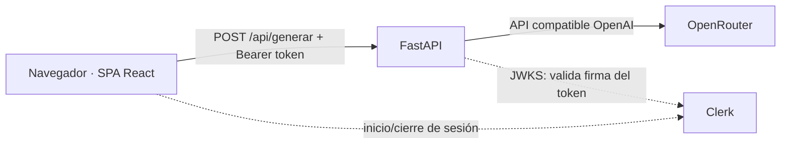

# Testia · Práctica UD1

Práctica UD1 del módulo *Explotación de Servicios de Procesamiento y Analítica de Datos* (Curso de especialización de IA). La miniapp genera un test de repaso a partir de unos apuntes; el foco de la práctica es **desplegarla, securizarla y operarla** en Vercel y AWS.

| Entorno | URL | Versión desplegada |
| --- | --- | --- |
| Vercel (serverless) | https://testia.vercel.app | `v0.4-auth` (+ ajuste de estilos `aa6af88`) |
| AWS EC2 (Docker) | `TODO` http://IP_PUBLICA | `TODO` `v1.0-aws` |

> Estado: Vercel + Clerk y Docker listos; EC2 en curso. Las secciones con `TODO` se completan al cerrar cada hito.

## 1. Identificación

- **Miniapp:** generador de tests tipo test con feedback (apuntes + nº de preguntas + dificultad → preguntas con explicación). Una pantalla, un formulario y una única operación de IA.
- **Integrantes:** trabajo individual (autorizado) de **Juan Amador** · GitHub `JHinGalv`. Se encarga de todo: backend, frontend, Vercel, Clerk, Docker, AWS, pruebas y documentación.

## 2. Plan de documentación

- **Lectores:** quien corrige la práctica y cualquier persona que deba reproducir el despliegue desde cero (sabe usar terminal, Git y Docker, pero no conoce el proyecto).
- **Tipo de documento:** siguiendo [Diátaxis](https://diataxis.fr/), el README combina *how-to* (pasos reproducibles por entorno), *referencia* (tabla de variables, comandos) y una breve *explicación* (arquitectura y decisiones). No incluye tutoriales genéricos.
- **Estructura:** un único README con las 12 secciones del enunciado; capturas en [`evidencias/`](evidencias/).
- **Actualización:** se documenta cada fase al cerrar su hito, con los comandos realmente usados y su captura (datos sensibles ocultos); el tag de Git marca qué versión describe cada sección.
- **Herramientas:** Markdown con vista previa (VS Code / GitHub), tablas y enlaces relativos, [Mermaid](https://mermaid.js.org/) para el esquema, recortes de pantalla con ocultación de datos, Git para revisar los cambios. Guía de formato: [Markdown de GitHub](https://docs.github.com/en/get-started/writing-on-github).

## 3. Arquitectura



1. La SPA inicia sesión con Clerk y obtiene un token de sesión (JWT de vida corta).
2. Envía los apuntes a `POST /api/generar` con `Authorization: Bearer <token>`.
3. FastAPI valida el token (firma, caducidad y origen `azp`) **antes** de llamar a la IA; sin token válido responde `401`.
4. FastAPI llama a OpenRouter con su clave (solo existe en el servidor), valida el JSON del modelo y lo devuelve.

| | Vercel | AWS EC2 |
| --- | --- | --- |
| Ejecución del backend | Vercel Function (Python), se arranca por petición | Proceso `uvicorn` permanente dentro de un contenedor |
| SPA | Estáticos de `frontend/dist` servidos por la CDN de Vercel | Servidos por FastAPI (`StaticFiles`) en el mismo contenedor |
| Compilación | Vercel ejecuta `buildCommand` en cada despliegue | `docker build` multietapa |
| Secretos | Variables de entorno de Vercel | Archivo privado `--env-file` en la instancia |
| HTTPS | Incluido | No (HTTP, solo demo con cuentas de prueba) |

## 4. Requisitos e instalación local

Versiones usadas: Python 3.14 (local) / 3.12 (Vercel y Docker), Node 24, npm 11, Docker 28, Git 2.48, Vercel CLI 63. Dependencias principales: FastAPI 0.143, openai 3.29, clerk-backend-api 7.0, React 19.3, Vite 8.3, Tailwind 4.3, @clerk/react 6.17.

```bash
# Backend
python -m venv .venv
.venv/Scripts/python -m pip install -e ".[dev]"   # Linux/macOS: .venv/bin/python
cp .env.example .env                               # y rellena tus valores
.venv/Scripts/python -m pytest                     # 6 tests, sin llamadas reales a la IA
.venv/Scripts/python -m uvicorn backend.app.main:app --reload --port 8000

# Frontend (en otra terminal)
cd frontend && npm ci && npm run dev               # http://localhost:5173 (proxy /api -> :8000)
```

Vite lee el mismo `.env` de la raíz (`envDir: '..'`) y solo expone al navegador las variables `VITE_*`.

Comprobación: `GET /api/health` devuelve `{"status":"ok"}`; en la SPA, sin sesión el botón pide iniciar sesión y, con sesión, se genera el test.

## 5. Variables de entorno

| Variable | Finalidad | Tipo | Dónde se configura | Cuándo se usa |
| --- | --- | --- | --- | --- |
| `OPENROUTER_API_KEY` | Llamada al proveedor de IA | **Secreto** | `.env` local · Vercel (Production/Preview) · `--env-file` en EC2 | Ejecución |
| `OPENROUTER_MODEL` | Modelos `:free` separados por comas (el primero es el principal; los demás, respaldo) | Config | idem | Ejecución |
| `OPENROUTER_TIMEOUT_SECONDS` | Timeout de la llamada | Config | idem | Ejecución |
| `CLERK_SECRET_KEY` | Validar la sesión en el backend (descarga la JWKS) | **Secreto** | idem | Ejecución |
| `CLERK_AUTHORIZED_PARTIES` | Orígenes de la SPA admitidos en el claim `azp`. `*` = un trozo de subdominio | Config | idem (valor distinto por entorno) | Ejecución |
| `VITE_CLERK_PUBLISHABLE_KEY` | Clerk en la SPA | Público (va en el bundle) | `.env` · Vercel · `--build-arg` en Docker | **Compilación** (si cambia, recompilar/reconstruir) |

Valores de `CLERK_AUTHORIZED_PARTIES` por entorno:

| Entorno | Valor |
| --- | --- |
| Local | `http://localhost:5173,http://localhost:8080` |
| Vercel Production | `https://testia.vercel.app,https://expl-p1.vercel.app,https://test-repaso-ia.vercel.app` |
| Vercel Preview | `https://testia-*-ies-zaidin-vergeles.vercel.app` (cada Preview tiene una URL distinta) |
| EC2 | `http://IP_PUBLICA` |

## 6. Vercel

**Organización (un único proyecto `testia`, equipo `ies-zaidin-vergeles`):** Vercel detecta FastAPI por `[tool.vercel] entrypoint` en `pyproject.toml` y lo ejecuta como una sola Vercel Function (Python 3.12, región `iad1`). `vercel.json` define el build del frontend (`npm --prefix frontend ci && npm --prefix frontend run build`) y `maxDuration` de 60 s. El backend monta `frontend/dist`, que Vercel sirve desde la CDN; las rutas `/api/*` van a la función. `.vercelignore` evita subir `.env`, cachés y artefactos. No se usa Docker en Vercel.

**Operaciones reales con la CLI** (en Windows con PowerShell restringido se usó `vercel.cmd`):

| Comando | Finalidad | Resultado |
| --- | --- | --- |
| `vercel login` / `vercel whoami` | Autenticar y comprobar la sesión | Sesión iniciada |
| `vercel link --yes --project test-repaso-ia` | Crear y vincular el proyecto único | Detecta FastAPI; crea `.vercel/` (ignorado por Git) |
| `vercel env add NOMBRE production\|preview --sensitive` (valor por stdin) | Subir variables sin escribir el secreto en el comando | `OPENROUTER_*` y después `CLERK_SECRET_KEY`, `CLERK_AUTHORIZED_PARTIES`, `VITE_CLERK_PUBLISHABLE_KEY` en Production y Preview |
| `vercel env ls` | Consultar nombres y entornos sin ver valores | Secretos como `Hidden` |
| `vercel env rm OPENROUTER_MODEL <entorno>` + `env add` | Actualizar una variable | Modelo cambiado a uno gratuito |
| `vercel deploy` | Despliegue de Preview | `testia-jhmhhp9ni-…vercel.app` `READY` |
| `vercel curl /api/generar --deployment <url> -- -X POST …` | Probar la Preview (protegida por *Vercel Authentication*) | `401` + `WWW-Authenticate: Bearer` sin token |
| `vercel deploy --prod` | Publicar el despliegue final | Alias `https://testia.vercel.app` |
| `vercel ls testia` | Consultar los despliegues del proyecto | Preview y Production `Ready` |
| `vercel project inspect testia` | Ver preset, build y región | FastAPI, `iad1` |
| `vercel project rename …` + `vercel domains add …` | Nombre definitivo de la app: **Testia** | `testia.vercel.app` responde en producción |
| `vercel logs --environment production --since 2h --no-follow` | Diagnosticar | Muestra los rechazos `SESSION_TOKEN_MISSING` / `TOKEN_INVALID` y, antes, un `403` de OpenRouter (ver sección 11) |
| `vercel inspect <url>` | Inspeccionar alias y función | Una función `fastapi` en `iad1` |

Subida de un secreto sin que aparezca en el comando ni en el historial (PowerShell):

```powershell
$sk = (Get-Content .env | Where-Object { $_ -match '^CLERK_SECRET_KEY=' }) -replace '^CLERK_SECRET_KEY=', ''
$sk | vercel.cmd env add CLERK_SECRET_KEY production --sensitive --yes
Remove-Variable sk
```

**Protección:** las Preview siguen protegidas por *Vercel Authentication* (*Standard Protection*); la URL de producción es pública para la evaluación, y la API de IA la protege Clerk.

## 7. Clerk

- **Instancia:** de **desarrollo** (claves `pk_test_` / `sk_test_`), como indica el enunciado. La etiqueta *Production* de Vercel no la convierte en producción. Usuario de prueba creado en *Users*; no se usan cuentas personales.
- **SPA** (`@clerk/react`): `ClerkProvider` con la clave pública y textos en español; en la cabecera, *Iniciar sesión* (modal de Clerk) o *Cerrar sesión* + `UserButton`. Sin sesión, el botón del formulario abre el inicio de sesión. Al enviar, `getToken()` obtiene el token y se manda como `Authorization: Bearer`.
- **Backend** ([`backend/app/auth.py`](backend/app/auth.py)): dependencia `usuario_autenticado` en `POST /api/generar` con el SDK oficial `clerk-backend-api` (`authenticate_request`): descarga la JWKS con `CLERK_SECRET_KEY`, comprueba **firma**, **caducidad** (`exp`/`nbf`), que el token sea de sesión y que el **`azp`** esté en `CLERK_AUTHORIZED_PARTIES`. Si falla → `401` con `WWW-Authenticate: Bearer` y la IA no se llama. En los logs solo se registra el motivo (`SESSION_TOKEN_MISSING`, `TOKEN_INVALID`, `AZP_NO_PERMITIDO`…), nunca el token. `/api/health` sigue siendo público y no revela nada.
- **Orígenes:** no se usa CORS (SPA y API comparten origen en ambos entornos). Los orígenes válidos se controlan con `azp`.
- **Ocultar el botón no es la protección:** la protección real es la validación en FastAPI.

Rechazo sin token en producción:

```console
$ curl -i -X POST https://testia.vercel.app/api/generar -H "Content-Type: application/json" --data-binary @cuerpo.json
HTTP/1.1 401 Unauthorized
Www-Authenticate: Bearer
{"detail":"Necesitas iniciar sesión para generar un test."}
```

Con un token inventado (`Authorization: Bearer token-inventado`) también responde `401` (log: `TOKEN_INVALID`).

> En PowerShell conviene pasar el cuerpo con `--data-binary @fichero`: si se escribe el JSON en línea, las comillas llegan mal y FastAPI responde `422` (JSON mal formado) antes de mirar la sesión.

## 8. Docker

Una sola imagen con la app completa ([`Dockerfile`](Dockerfile)), construida en dos etapas: `node:24-alpine` compila la SPA y `python:3.12-slim` ejecuta FastAPI, que sirve `/api/*` y la SPA. La imagen final no contiene Node, tests, `.env` ni la carpeta `.git` ([`.dockerignore`](.dockerignore)); se ejecuta con un usuario sin privilegios y tiene `HEALTHCHECK` contra `/api/health`.

```bash
# Construir (la clave PÚBLICA de Clerk entra en el bundle; los secretos NO van en la imagen)
docker build --build-arg VITE_CLERK_PUBLISHABLE_KEY=pk_test_... -t testia:$(git rev-parse --short HEAD) .

# Ejecutar: secretos inyectados al arrancar desde un archivo privado
docker run -d --name testia --env-file .env -p 8080:8000 --restart unless-stopped testia:<commit>

docker ps --filter name=testia          # estado (healthy)
docker logs --tail 50 testia            # logs
docker stop testia && docker start testia
docker restart testia
docker rm -f testia                     # retirar
```

- **Puerto:** `uvicorn` escucha en `0.0.0.0:8000` dentro del contenedor (en `127.0.0.1` no llegaría el tráfico del puerto publicado); en local se publica en `8080` y en EC2 en `80`.
- **Etiqueta de la imagen:** el commit corto, para saber qué versión corre (`docker ps` muestra `testia:aa6af88`).
- **Prueba local:** contenedor `healthy`, SPA en http://localhost:8080, `401` sin token, ningún secreto en `docker history`, proceso como usuario `app`.

## 9. AWS

`TODO` (Fase 6): EC2 (región, SO, tipo), Docker, ejecución, Security Group, URL y versión desplegada. Limitación a documentar: en EC2 la aplicación va por **HTTP sin cifrar** (el token de sesión viaja en claro), por lo que solo debe usarse con datos y cuentas de prueba.

## 10. Operación y verificación

**Tests automáticos** (`pytest`, sin llamadas de pago, IA simulada):

| Test | Qué comprueba |
| --- | --- |
| `test_entrada_valida_con_proveedor_simulado` | Petición válida → `200` con la estructura JSON esperada |
| `test_entrada_incorrecta_devuelve_422` | Apuntes vacíos, demasiadas preguntas o texto demasiado largo → `422` |
| `test_fallo_del_proveedor_es_error_controlado` | Error del proveedor → `502` sin filtrar detalles internos |
| `test_json_invalido_del_modelo_es_error_controlado` | El modelo devuelve algo que no es JSON → `502` |
| `test_sin_token_valido_se_rechaza_sin_llamar_a_la_ia` | Sin token o con token falso → `401` y la IA no se llama (validación real con el SDK) |
| `test_origenes_permitidos_admiten_comodin_de_preview` | El comodín de `azp` acepta las Preview y rechaza otros dominios |

Resultado: `6 passed`.

`TODO`: comprobaciones manuales en ambos entornos, estado/logs en EC2, actualización y reinicio, retirada de recursos al terminar.

## 11. Problemas y soluciones

1. **JSON incompleto / 502 con modelos gratuitos.** *Síntoma:* `RespuestaInvalida: JSON mal formado` o `Respuesta vacía`. *Diagnóstico:* con `finish_reason=length` y el contenido empezando por "Here's a thinking process", el modelo (de razonamiento) gastaba los tokens pensando. *Solución:* enviar `reasoning: {enabled: false}` en `extra_body` y subir `max_tokens`. *Comprobación:* prueba real de 3 y 10 preguntas con modelos `:free` (5,7 s y 6,7 s).
2. **`403 Forbidden` de OpenRouter solo en Vercel.** *Síntoma:* 502 controlado en `/api/generar` desplegado. *Diagnóstico:* `vercel logs` mostró `POST https://openrouter.ai/... 403`; la clave no tiene saldo y el modelo configurado era de pago. *Solución:* usar solo modelos `:free` (con lista de respaldo, porque a veces responden `429`). *Comprobación:* `200 OK` desde el despliegue de Preview.
3. **`.gitignore` modificado por la CLI.** `vercel link` añadió `.env*`, que anulaba `!.env.example`; se eliminó esa línea porque `.vercel/` y `.env.*` ya estaban cubiertos.
4. **PowerShell bloquea `npm`/`vercel`** (`running scripts is disabled`): se usaron `npm.cmd` y `vercel.cmd`, sin cambiar la política de ejecución. Además, para ejecutar una ruta entre comillas hace falta el operador `&`.
5. **El `.env` se subió a Vercel con el código.** *Síntoma:* al comparar el código desplegado con el local (`vercel api /v6/deployments/<id>/files`, hash SHA-1 de cada archivo), el árbol contenía `.env`, `.pytest_cache`, `egg-info` y un `dist` antiguo. *Diagnóstico:* sin repositorio Git la CLI no aplica el `.gitignore`. *Solución:* añadir `.vercelignore` (excluye `.env*`, cachés, `frontend/dist`) y redesplegar; el nuevo despliegue tiene solo archivos fuente, sin secretos. *Pendiente:* los despliegues antiguos aún contienen el `.env`; se recomienda rotar la clave de OpenRouter y retirar esos despliegues.
6. **Despliegue pausado y protegido.** *Síntoma:* `https://testia.vercel.app` devolvía `503 DEPLOYMENT_PAUSED` y, tras reactivarlo, `302` a la página de login de Vercel. *Solución:* reanudar el proyecto en el dashboard y cambiar *Deployment Protection* a *Standard Protection* (solo protege Preview). *Comprobación:* `GET /api/health` → `200` sin sesión de Vercel.
7. **`pip install -e .` fallaba** (`Multiple top-level packages discovered: ['backend', 'frontend']`). *Solución:* `[tool.setuptools.packages.find] include = ["backend*"]` en `pyproject.toml`. *Comprobación:* instalación y `pytest` correctos en un entorno nuevo.
8. **Las Preview de Vercel no tienen una URL fija para `azp`.** *Síntoma:* una lista exacta de orígenes rechazaría a usuarios autenticados en cada Preview nueva. *Solución:* admitir `*` en `CLERK_AUTHORIZED_PARTIES`, limitado a `[a-z0-9-]+` (no puede colar otro dominio), con test. *Comprobación:* `test_origenes_permitidos_admiten_comodin_de_preview`.
9. **El repositorio Git se creó tarde.** Las fases 1–3 se hicieron sin Git. Al integrar Clerk se creó el repositorio y se **reconstruyó el historial por fases** con los ficheros reales de cada fase (backend → frontend → configuración de Vercel), para que cada tag apunte a un commit distinto. Las fechas de esos commits son las de la reconstrucción, no las del trabajo original.

## 12. Git y evidencias

| Tag | Hito | Despliegue |
| --- | --- | --- |
| `v0.1-backend` | Backend mínimo, 4 tests | Local |
| `v0.2-frontend` | SPA conectada en local | Local |
| `v0.3-vercel` | Primer despliegue serverless | https://testia.vercel.app |
| `v0.4-auth` | Clerk en SPA y backend, redespliegue | https://testia.vercel.app |
| `v0.5-docker` | Imagen única probada en local | http://localhost:8080 |
| `v1.0-aws` | `TODO` Despliegue en EC2 | `TODO` |

Evidencias en [`evidencias/`](evidencias/) (datos personales ocultos):

| Captura | Qué demuestra |
| --- | --- |
| [`vercel-clerk-login.png`](evidencias/vercel-clerk-login.png) | En https://testia.vercel.app, sin sesión el formulario no permite generar; el modal de Clerk muestra *Development mode* (instancia de desarrollo). |
| [`vercel-clerk-sesion-test.png`](evidencias/vercel-clerk-sesion-test.png) | Con sesión iniciada aparecen *Cerrar sesión* y el menú de usuario, y el test se genera con respuesta real de la IA (en `vercel logs`: `POST /api/generar` → OpenRouter `200 OK`). |
| `TODO` | Docker local, EC2, Security Group, `vercel env ls`, rechazo sin token. |
